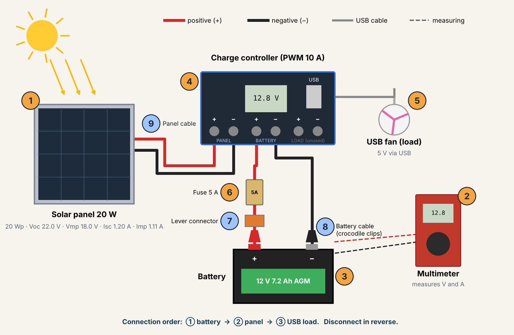
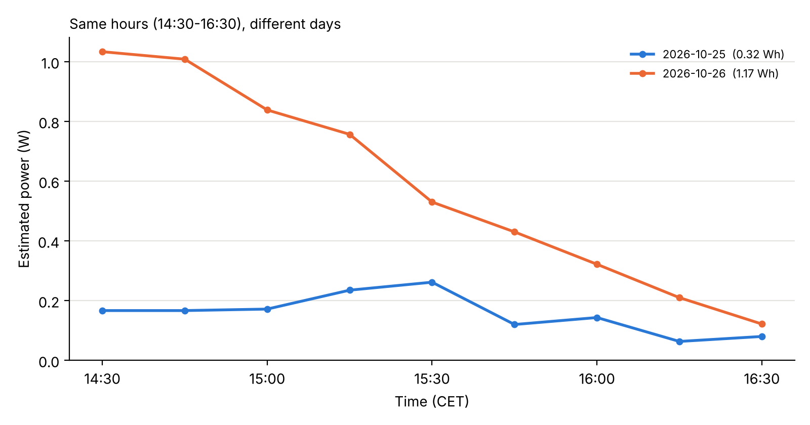
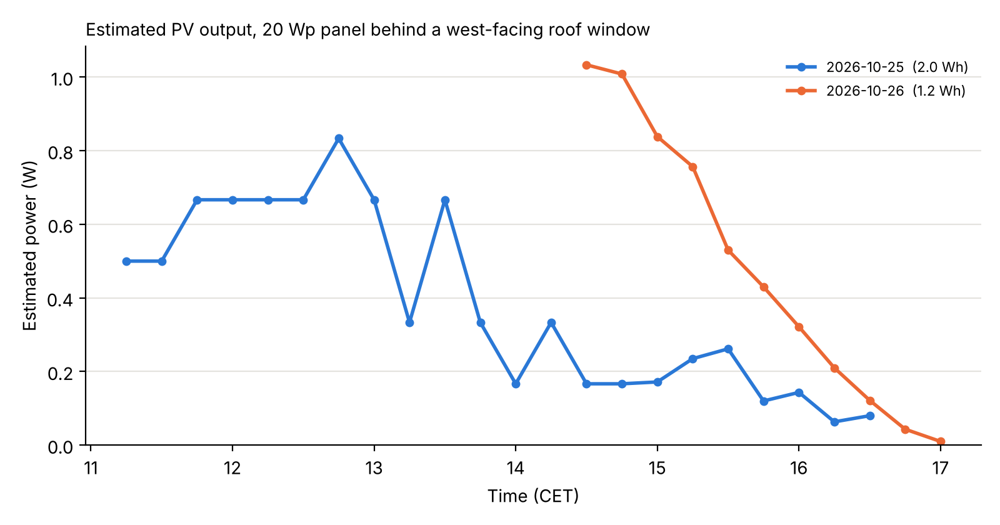

# Desk-Scale Solar + Battery System: Measuring Real PV Output

> ✍️ **[Your words — 2–3 sentences: who you are, why you built this, what question you wanted to answer.]**

A 20 Wp solar panel, a PWM charge controller and a 12 V AGM battery, built and measured over three days (25–27 Oct 2026) in Passau, Germany. The panel's short-circuit current was logged every 15 minutes to estimate how much energy it produces through a real day.



## System

| # | Part | Key specs |
|---|---|---|
| 1 | Nicesolar monocrystalline panel | 20 Wp ±5%, Voc 22.0 V, Vmp 18.0 V, Isc 1.20 A, Imp 1.11 A (STC) |
| 2 | AstroAI AM33D multimeter | V DC, A DC (10 A and 200 mA ranges) |
| 3 | Greencell Cube battery | 12 V, 7.2 Ah, AGM VRLA |
| 4 | Nicesolar PWM charge controller | 12/24 V, 10 A, USB output, set to lead-acid (b01) |
| 5 | Inline fuse | 5 A on battery + |
| 6 | USB fan | load |

**Connection order:** battery → panel → load. Disconnect in reverse.

## Method

1. **Open-circuit voltage (Voc)** measured once with the multimeter as a voltmeter.
2. **Short-circuit current (Isc)** logged continuously: the multimeter on a current range (10 A, or 200 mA for weak light) shorts the panel, and a laptop camera recorded the display. Readings were taken from the video every 15 minutes.
3. **Isc is proportional to irradiance**, so power is estimated as:

```
P(t) ≈ Isc(t) / Isc,STC × 20 W          (Isc,STC = 1.20 A)
G(t) ≈ Isc(t) / Isc,STC × 1000 W/m²
Energy = ∫ P dt   (trapezoidal rule)
```

Equivalent view: P = FF × Voc × Isc, with fill factor FF = (18.0 × 1.11) / (22.0 × 1.20) ≈ 0.76.

**Setup:** panel fixed behind the glass of a west-facing roof window (azimuth 284°), not moved during logging.

## Results

### Same hours, different days (14:30–16:30)

Same panel, same position, same clock window: only the weather changes.



| Day | Weather | Mean Isc | Energy 14:30–16:30 |
|---|---|---|---|
| Sun 25 Oct | Overcast, rain | 9.4 mA | 0.32 Wh |
| Mon 26 Oct | | 35.0 mA | 1.17 Wh (≈ 3.6× Sunday) |
| Tue 27 Oct | | | |

### Everything logged



| Day | Logged | Peak | Energy (logged window) |
|---|---|---|---|
| Sun 25 Oct | 11:15–16:30 | 0.05 A at 12:45 (≈ 0.83 W, ≈ 42 W/m²) | ≈ 2.0 Wh |
| Mon 26 Oct | 14:30–17:00 | 62 mA at 14:30 (≈ 1.03 W, ≈ 52 W/m²) | ≈ 1.2 Wh |
| Tue 27 Oct | | | |

**Spot readings**

| ID | Measurement | Value |
|---|---|---|
| R1 | Battery voltage at rest | 12.94 V |
| R2 | Battery voltage on controller display | 12.7 V |
| R3 | Battery voltage with fan running | 12.68 V |
| R4 | Panel Voc (overcast, behind glass) | 21.8 V (99% of rated) |
| R5 | Panel Isc (same conditions) | 0.04 A (3% of rated) |

## Observations

- Under heavy overcast, **voltage stayed at 99% of rated while current fell to ~3%**: light intensity drives current, not voltage.
- On the overcast day the peak came around midday: diffuse light makes the window's orientation matter less.
- Battery voltage dropped 0.26 V under the fan load (internal resistance).

> ✍️ **[Your words — what surprised you, what you learned, what you'd do next.]**

## Limitations

- Power is **estimated** from Isc, not measured at the maximum power point; real output in weak light is slightly lower.
- 10 A range resolution is 0.01 A, so low-light readings are coarse (switched to the 200 mA range on 25 Oct from 14:51).
- Panel is behind window glass (~10–15% loss) and faces west, not south.
- Monday morning was not recorded: the meter's red lead was in the mA socket while the dial was on the 10 A range, so it read 0.00 all morning. Lesson learned: the dial and the socket must always match.

## Reproduce

```bash
pip install matplotlib
python analysis/plot_production.py   # all logged data -> figures/production_curve.png
python analysis/compare_window.py    # 14:30-16:30 per day -> figures/window_comparison.png
```

Data: `data/*.csv` (columns: `date, time, isc_A, range, source`).

## Credits

Built and measured by Mohamed Eniw, B.Eng. Energy Systems Engineering student, Deggendorf Institute of Technology (THD).
The analysis script and figures were prepared with the help of an AI assistant (Claude); all measurements were taken by hand.
