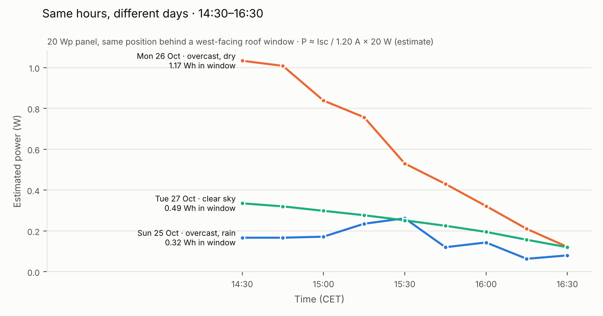
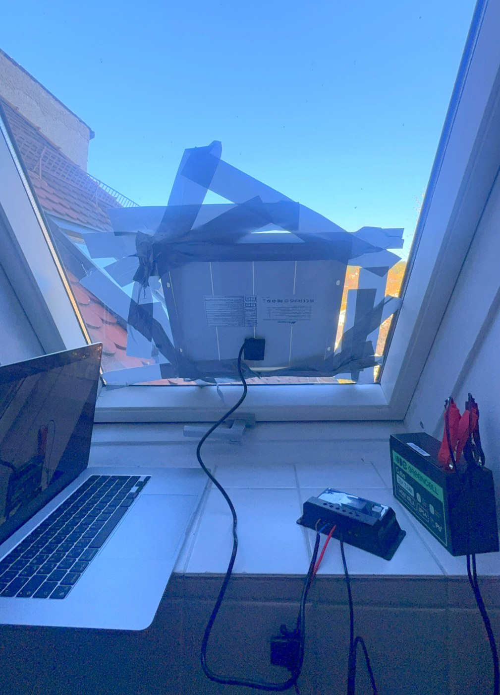

# Desk-Scale Solar + Battery System: Measuring Real PV Output

I'm a first-year Energy Systems Engineering student at Deggendorf Institute of Technology (THD) in Germany. I built this small off-grid system to see with my own instruments what the textbook says about solar PV: how much a real panel produces through a real day, how much the weather changes that, and why a system needs storage.

The system is a 20 Wp solar panel, a PWM charge controller and a 12 V AGM battery, tested over three days (25–27 Oct 2026) in Passau, Germany. The panel's short-circuit current was logged every 15 minutes to estimate how much energy it produces.


## System

| # | Part | Key specs |
|---|---|---|
| 1 | Nicesolar monocrystalline panel | 20 Wp ±5%, Voc 22.0 V, Vmp 18.0 V, Isc 1.20 A, Imp 1.11 A (STC) |
| 2 | AstroAI AM33D multimeter | V DC, A DC (10 A and 200 mA ranges) |
| 3 | Greencell Cube battery | 12 V, 7.2 Ah, AGM VRLA |
| 4 | Nicesolar PWM charge controller | 12/24 V, 10 A, USB output, set to lead-acid (b01) |
| 5 | Inline fuse | 5 A on battery + |
| 6 | USB fan | load |

**Connection order:** battery → panel → load. Disconnect in reverse.

## Method

1. **Open-circuit voltage (Voc)** measured with the multimeter as a voltmeter.
2. **Short-circuit current (Isc)** logged continuously: the multimeter on a current range (10 A, or 200 mA in weak light) shorts the panel, and a laptop camera recorded the display. Readings were taken from the video every 15 minutes.
3. **Isc is proportional to irradiance**, so power is estimated as:

```
P(t) ≈ Isc(t) / Isc,STC × 20 W          (Isc,STC = 1.20 A)
G(t) ≈ Isc(t) / Isc,STC × 1000 W/m²
Energy = ∫ P dt   (trapezoidal rule)
```

Equivalent view: P = FF × Voc × Isc, with fill factor FF = (18.0 × 1.11) / (22.0 × 1.20) ≈ 0.76.

**Setup:** panel fixed behind the glass of a west-facing roof window (azimuth 284°), not moved between days.

## Results

### Same hours, different days (14:30–16:30)

Same panel, same position, same clock hours: only the weather changes. Both days were overcast; the difference is the rain.



| Day | Weather | Logged | Peak | Energy, logged span | Energy, 14:30–16:30 |
|---|---|---|---|---|---|
| Sun 25 Oct | Overcast, rain (high 10 °C) | 11:15–16:30 | 50 mA at 12:45 (≈ 0.83 W, ≈ 42 W/m²) | ≈ 2.0 Wh | 0.32 Wh |
| Mon 26 Oct | Overcast, dry (high 12 °C) | 14:30–17:00 | 62 mA at 14:30 (≈ 1.03 W, ≈ 52 W/m²) | ≈ 1.2 Wh | **1.17 Wh (≈ 3.6× Sunday)** |
| Tue 27 Oct | | | | | |

Weather: Apple Weather, Passau, recorded conditions.

### Spot readings

| ID | Measurement | Value |
|---|---|---|
| R1 | Battery voltage at rest | 12.94 V |
| R2 | Battery voltage on controller display | 12.7 V |
| R3 | Battery voltage with fan running | 12.68 V |
| R4 | Panel Voc (overcast, behind glass) | 21.8 V (99% of rated) |
| R5 | Panel Isc (same conditions) | 0.04 A (3% of rated) |

## Observations

- Under heavy overcast, **voltage stayed at 99% of rated while current fell to ~3%**: light intensity drives current, not voltage.
- On the rainy day the output was flat and uneven; on the dry day it faded smoothly towards sunset.
- On the rainy day the peak came around midday: under thick cloud the light is diffuse, so the window's orientation matters less.
- Battery voltage dropped 0.26 V under the fan load (internal resistance).

## What I learned

- **Voltage is not the story, current is.** I expected a dark, rainy day to "turn the panel off". The voltage barely moved; the current, and with it the power, collapsed to a few percent.
- **Compare like with like.** Comparing the same clock hours on different days isolates the weather. Same panel, same window, same hours: the dry day gave about 3.6× the energy of the rainy one.
- **Solar output swings from one day to the next, so storage matters.** On a rainy day a 20 W panel made about 2 Wh. A battery turns that uneven daytime supply into energy I can use whenever I need it. At grid scale, that is exactly the role of storage and flexibility in a renewable energy system.
- **Range choice is a trade-off.** The 10 A range is safe in full sun but only resolves 0.01 A; the 200 mA range resolves 0.1 mA but saturates in bright light. I used 200 mA in weak light and 10 A when the sun could get strong.

## Next steps

- Log a full day from sunrise to sunset (Tuesday 27 Oct).
- Measure real power under load (voltage and current at the same time) instead of estimating it from Isc.
- Repeat with the panel outside and facing south, and compare with the window results.

## Limitations

- Power is **estimated** from Isc, not measured at the maximum power point; real output in weak light is slightly lower.
- 10 A range resolution is 0.01 A, so low-light readings on that range are coarse.
- Panel is behind window glass (~10–15% loss) and faces west, not south.

## Reproduce

```bash
pip install matplotlib
python analysis/compare_window.py   # 14:30-16:30 per day -> figures/same_hours_comparison.png
python analysis/daily_summary.py    # peak and energy for every logged day
```

Data: `data/*.csv` (columns: `date, time, isc_A, range, source`). Full readings log: [`docs/readings_log.pdf`](docs/readings_log.pdf).

## Test setup



*The test setup in Passau: panel fixed behind a west-facing roof window, with the charge controller, battery and the laptop camera recording the multimeter.*

## Credits

Built and measured by Mohamed Eniw, B.Eng. Energy Systems Engineering student, Deggendorf Institute of Technology (THD).
The analysis script and figures were prepared with the help of an AI assistant (Claude); all measurements were taken by hand.
